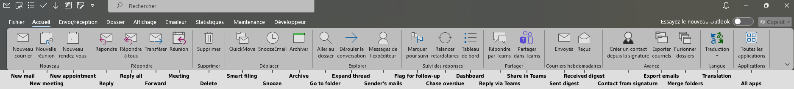
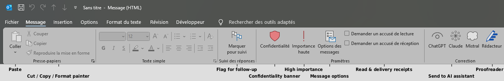
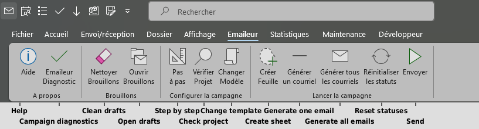
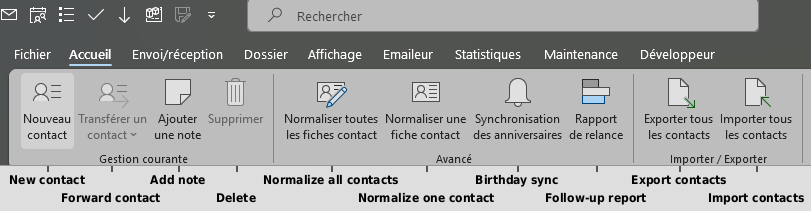
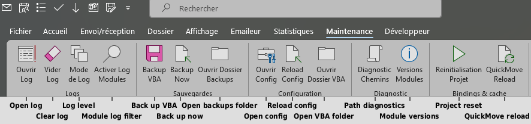

# ClassicOutlook-Toolkit

[](LICENSE)
[-0078D4.svg)](#requirements)
[](#whats-inside)
[](https://github.com/alexandre-gambuto/ClassicOutlook-Toolkit/releases)
[](https://github.com/alexandre-gambuto/ClassicOutlook-Toolkit/commits/main)

A productivity automation suite for **Outlook Classic (desktop)** by **Alexandre Gambuto**,
written entirely in VBA, with three companion Excel workbooks (mail tracking, mail
campaigns, time tracking). It grew out of daily knowledge-work needs: filing mail in two
keystrokes, tagging appointments by project, filing replies automatically, colouring
meetings by attendee type, running small mail campaigns, tracking which sent mails are
still awaiting a reply, keeping the address book clean, mail statistics, and more.

Everything runs inside a single Outlook VBA project (`ThisOutlookSession`, five
`WithEvents` classes, 59 standard modules and the two UserForms of the mail
statistics module, roughly 66,000 lines), with all business configuration externalized
to a `config.ini` file. The UI is **bilingual** (French / English), switchable from one
config key; the ribbon labels are in French.

Version 3 (September 2026) is a full code review: multi-mailbox reply filing,
asynchronous campaigns, a self-healing folder index, shared infrastructure modules and
an extended source validator. See `RELEASE-NOTES-v3.md` and `CHANGELOG.txt`.

Project pages, with screenshots and a feature tour written for users: in English
https://alexandre-gambuto.com/classicoutlook-toolkit-en/, en français https://alexandre-gambuto.com/classicoutlook-toolkit/.



## Highlights

- **Zero-install, locked-down friendly.** No admin rights, no installer, no registered
  COM, no `Tools > References` entries. Late binding everywhere; registry writes limited
  to `HKCU`; no PowerShell and no command prompt: the only programs started are `mshta`
  (toasts), `notepad` (log and reports) and `explorer` (open a folder), plus the default
  browser or application through `Shell.Application`. Designed to survive a managed M365
  tenant with an EDR agent.
- **Almost no UserForms.** The VBA Project Object Model is assumed blocked, so
  interaction goes through ribbon-pinned macros, `MsgBox` / `InputBox` and small toast
  notifications. The only two forms are the windows of the mail statistics module.
- **64-bit clean.** Every `Declare` uses `PtrSafe` and `LongPtr`.
- **Config-driven.** Project codes, patterns, colours, paths, thresholds, vocabulary and
  feature toggles live in `config.ini`, loaded once at startup into typed globals.
- **Centralized logging** with four levels (`ERROR/INFO/DEBUG/TRACE`) and per-module
  filtering.
- **Bilingual UI.** `Language=FR` or `Language=EN`; every user-facing string goes through
  a `T(fr, en)` helper. Logs and functional strings stay as they are.
- **Validated sources.** `validate.py` checks every file before it is pasted into the
  VBE: declaration order, balance, encoding, accent markers, duplicate declarations,
  cross-module references, config keys.
- **Guided first run.** With no `config.ini`, a quick start guide offers, a few seconds
  after startup, to check the environment, ask five questions and write a minimal
  configuration file. Re-run it any time from the *Maintenance* ribbon tab
  (*Guide de démarrage*).
- **Self-protecting startup.** Startup work is deferred and run one heavy task at a time;
  after three abnormal Outlook stops in a row, the startup tasks are suspended until
  `ResumeStartupTasks` is run.

---

## Screenshots

| | |
|---|---|
|  |  |
|  |  |

The time-tracking sheet (`docs/images/dashboard-time-tracking.png`) is shown in `docs/FEATURES.md`.

## Documentation

| Document | Content |
|----------|---------|
| `docs/FEATURES.md` | Feature tour by theme, written for users. |
| `docs/INSTALL.md` | Step-by-step installation and upgrade guide. |
| `docs/CONFIGURATION.md` | `config.ini` key reference. |
| `docs/TROUBLESHOOTING.md` | Known pitfalls of Outlook VBA in a locked-down environment. |
| `ARCHITECTURE.md` | Module topology, startup flow, event routing, ribbon entry points, files written, conventions. |
| `docs/GUIDE-Campagnes.md` | Mail campaigns guide (French). |
| `modMailAnalytics__README.txt` | Mail statistics notice. |
| `CONTRIBUTING.md` | Coding conventions and delivery rules. |
| `RELEASE-NOTES-v3.md` | What changed in version 3. |
| `CHANGELOG.txt` | Full change history, newest first. |

---

## What's inside

### Orchestration

| File | Role |
|------|------|
| `ThisOutlookSession` | Single entry point: `Application_Startup`, global Outlook events, ribbon shims. |
| `clsAppEvents` | Central `WithEvents` listener on `Application.Inspectors`, the mail Explorer and `Application.Explorers` (first window of a session started without one); routes events to the right modules. |
| `clsApptWatcher` | Per-appointment watcher (anti-overlap, colouring, Teams block cleanup). |
| `clsExplorerWatcher` | Keeps one Explorer window pinned to the mail role and one to the calendar role (dual-monitor setup). |
| `clsInboxWatcher` | Watches the Inbox of one mailbox for new-mail alerts. |
| `clsFolderWatcher` | Watches folder creations, renames and deletions so the QuickMove list stays current without a rescan. |

### Configuration and infrastructure

| Module | Role |
|--------|------|
| `modConfig` | Loads `config.ini` into typed globals; getters, the `T()` bilingual helper and the `A()` accent decoder. |
| `modDebugLog` | 4-level logger with per-module filtering and a rotating log file. |
| `modDefer` | Central deferred-action scheduler (`SetTimer` based): the only reliable way to run "in N seconds" code in this Outlook session. |
| `modCommon` | Shared stateless helpers (file-name sanitizing, HTML escaping, folder resolution, safe property access, Excel liveness test). |
| `modUi` | Single entry point for dialogs: foreground guarantees, topmost, a toast when an input box is waiting behind another window. |
| `modMsgBoxCustom` | `MsgBox` with renamed buttons and an auto-close countdown that pauses while Outlook is in the background. |
| `modNotify` | Non-blocking, auto-closing toast notifications (multi-monitor aware). |
| `modSmtp` | SMTP resolution (current user, recipients, organizer, sender), internal-domain test, session cache. |
| `modExcelBridge` | Shared Excel COM lifecycle: ghost instance detection, stealth open with retry, block reads, safe save and close. |
| `modInspectorQueue` | Keeps Inspector objects alive between `NewInspector` and a deferred pass. |
| `modStoreContext` | Default store and mailbox context helpers. |
| `modDevTools` | Dev helpers, including hot-reload (`Reinit`) without restarting Outlook. |
| `modMaintenance` | Maintenance menu: logs, backups, config reload, bindings check, paths diagnosis, module versions (full list written to `Sorties\versions-modules.txt`), caches. |
| `modQuickStart` | First-run quick start guide: environment check, five questions, minimal `config.ini`. |
| `modBackupVBA` / `modBackupAuto` | Manual and monthly automated backup of the VBA project, ribbon exports, workbooks, caches and registry settings (exported in pure VBA), with a size alert on the VBA project file. |

### Mail

| Module | Role |
|--------|------|
| `modQuickMove` | Fast filing into the folder trees of all mailboxes: code detection, folder search, recent history, self-healing index, undo of the last filing, filing of the sent mails waiting in the queue. |
| `modReplyInPlace` | Files sent replies and forwards into the folder of the parent message, in any mailbox. |
| `modReplyGreeting` | Inserts a personalised greeting line at the top of replies ("Hello all" variant for several recipients). |
| `modProjectTag` | Project, contract and opportunity tagging; creates referential entries on the fly. |
| `modMigrateTags` | One-shot migration of legacy tag properties. |
| `modMailCampaign` | Engine of the mail campaigns driven from the campaigns workbook: drafts, asynchronous throttled send, per-row status, reply tracking, follow-ups, stop command. |
| `modMailConfidentiality` | Cyclic confidentiality and urgency banner (none, confidential, urgent, personal), subject prefix, sensitivity sync. |
| `modMailResponseTracker` | Tracks sent mail awaiting a reply, with an Excel dashboard; morning reminder without opening Excel; follow-ups prepared from the workbook. |
| `modReplySuspicion` | Post-send scoring to detect mails likely awaiting a reply (configurable vocabulary). |
| `modInboxAlert` | Per-mailbox new-mail alerts with grouping, sound and colour. |
| `modHideBcc` | Hides the Bcc field on every new compose window. |
| `modSnooze` | Postpones selected mails to a chosen date and time; brings back at startup the mails whose reminder was missed. |
| `modSearch` | Quick "received / sent this week" searches, and back to the Inbox. |
| `modMailExport` | Batch export of selected mails to PDF and/or Word. |
| `modMarkAllRead` | Marks every unread mail of the mailbox shown on screen as read. |
| `modThreadAttachments` | Re-attaches, in one click, files that circulated earlier in the thread. |
| `modFolderScan` | Auto-archives inactive project subfolders after startup. |
| `modFolderMerge` / `modFolderSort` / `modFolderRename` | Merge two folders, put sibling folders back in A-Z order, mass-rename project folders after a CSV review. |
| `modViewGuard` | "Standardize view": consistent From / To column in every mail folder (manual command). |
| `modPurgeCategories` | Removes the automatic meeting categories from past appointments. |
| `modSendToLLM` | Sends the text being written (quoted history excluded) to a browser-based writing assistant; asks first for a confidential mail. |

### Calendar

| Module | Role |
|--------|------|
| `modMeetingColor` | Auto-colours meetings by attendee nature (internal, external, commercial). |
| `modAntiOverlap` | Shifts a short plain appointment that collides with an existing one (meetings are never moved). |
| `modNewMeetingDefault` | Default duration for new appointments (only when Outlook's own default slot is kept). |
| `modMeetingToAppointment` | Turns a meeting with no third-party invitee back into a plain appointment and removes the Teams block. |
| `modAppointmentPrivacy` | Sets appointments of configured organizers to private. |
| `modShiftAppointment` / `modFlashAppointment` | Shift an appointment by 15 minutes; create a quick "flash" slot. |
| `modMaximizeWindow` | Opens new inspector windows maximized. |

### Contacts

| Module | Role |
|--------|------|
| `modContactFromMail` | Creates a contact card from the signature of the selected mail. |
| `modContactEnrich` | Fills in the missing e-mail addresses and phone numbers of contact cards from the user's mail. |
| `modContactBirthday` | Yearly birthday and name-day events synchronised with contact cards. |
| `modContactNormalize` | Harmonises cards across all contact folders (names, phones, addresses, duplicates). |
| `modContactRelation` | "Cooling relationships" report from the mails sent, in every mail folder. |
| `modContactNote` | Dated journal entries at the top of a contact card. |
| `modContactExport` / `modContactImport` | CSV export and re-import of every contact folder, photos included. |
| `modContactCommon` | Helpers shared by the contact modules, and the undo file of bulk card changes (`ContactUndoLastRun`). |

### Mail statistics

`modMailAnalytics` (with its `frmConfig` / `frmProgress` UserForms) is part of the
Outlook project (*Statistiques* ribbon tab). It scans the mailboxes and writes a
multi-sheet Excel report: volumes, sent and received, internal and external, To versus
Cc share, weekday and hour distributions, monthly and yearly evolution, heatmaps, top
contacts, reply rate and reply delay. Two commands: `RunEmailAnalysis` (full analysis)
and `RunEmailAnalysisDelta` (adds only the mails received since the latest report). It
has its own notice (`modMailAnalytics__README.txt`).

### Companion workbooks

Each workbook has its own VBA project and its own ribbon tab; it talks to Outlook through
a note in a dedicated Notes folder (command channel), never by calling Outlook macros.

| Workbook | Role |
|----------|------|
| Mail tracking (`Suivi des mails.xlsm`) | Dashboard of the tracked mails: refresh, follow-up drafts on ticked rows, archive. |
| Campaigns (`Suivi des Campagnes.xlsm`) | One sheet per campaign: contacts import, messages, checks, drafts, send, replies, follow-ups. |
| Time tracking | Projects and hours per month, filled from the tagged appointments. Its code is private and not published (only a template of its structure). |

### Archived

| Module | Role |
|--------|------|
| `modOneNote` / `modOneNoteProbe` | OneNote reorganization and its diagnostic probe. Kept in the repository but no longer part of the installed project (OneNote COM blocked on the target workstation). |

### Ribbon

The `*.exportedUI` files are exported Outlook ribbon customizations that bind the
buttons to the public macros, one file per Outlook window: main window
(`Accueil_Tous_les_onglets_principaux`), read message (`Onglets_principaux_Message`),
new message (`Onglets_principaux_Nouveau_courrier`) and appointment
(`Onglets_principaux_Nouveau_rendez-vous`). Import each file once, from a window of
the same kind (main window, an open message, a new message, an appointment), via *File >
Options > Customize Ribbon > Import/Export*: an import replaces the whole customization
of that window, so export the current one first as a backup.

---

## Requirements

- **Outlook Classic** (desktop). Not New Outlook, not Outlook on the web.
- **64-bit Office** (the `Declare` statements assume it).
- Windows, with the usual scripting hosts available (`WScript.Shell`, `Scripting`,
  `MSXML`), all used through late binding.
- Excel with VBA, for the statistics report and the companion workbooks.
- Python 3 (optional) to run `validate.py` before pasting.

---

## Installation (short version)

Because the VBA Project Object Model is assumed blocked, modules are pasted in by hand.

1. `Alt+F11` to open the VBA editor in Outlook.
2. Paste the infrastructure modules first (`modConfig`, `modDebugLog`, `modCommon`,
   `modUi`, `modDefer`, `modSmtp`, `modExcelBridge`, `modContactCommon`,
   `modInspectorQueue`, `modNotify`, `modMsgBoxCustom`, `modStoreContext`), then the
   others. Class modules (`clsAppEvents`, `clsApptWatcher`, `clsInboxWatcher`,
   `clsExplorerWatcher`, `clsFolderWatcher`) go into class modules; `ThisOutlookSession` into the existing
   object of that name; `frmConfig` / `frmProgress` are imported from their `.frm` files
   (or created and filled with the `*_Code.txt` code). Modules delivered together call
   each other: paste the whole set before compiling (order in
   `ARCHITECTURE.md`, section 8). `modOneNote` / `modOneNoteProbe` are not
   installed (an existing project removes them with *File > Remove*, after the new
   `modMaintenance`).
3. Create the toolkit folder `ClassicOutlook-Toolkit` (on the Desktop, at the root of
   a OneDrive, or one level below, e.g. `OneDrive\VBA\ClassicOutlook-Toolkit`), copy
   `config.ini.example` into it as `config.ini` and edit it
   for your environment.
   Outlook finds the folder at startup and remembers it (macro `SetToolkitFolder` to
   pick another one). Workbooks go in `Classeurs\`; logs, exports and backups are
   written to `Sorties\`. The former location `<Desktop>\Macro VBA\Outlook\` still
   works. `python validate.py --config config.ini` lists keys unknown to the code.
4. *Debug > Compile*, close the VBE, restart Outlook.
5. Import the `*.exportedUI` ribbon files if you want the buttons: each file once,
   one per window (see *Ribbon* above).

The full procedure, including upgrades from earlier versions, is in `docs/INSTALL.md`.

---

## Configuration

All business constants live in `config.ini`; see `docs/CONFIGURATION.md` and the
commented `config.ini.example`. `config.ini` itself is **gitignored** (it contains
environment-specific values); only `config.ini.example` is tracked.

---

## Repository layout

All sources sit at the root of the repository; the author's working copy groups the same
files by application (`Outlook\`, `Excel\`, `Interface\`, `Docs\`, `Outils\`).

```
ThisOutlookSession.txt, cls*.txt, mod*.txt   Outlook VBA (paste into the VBE);
                                             modOneNote*.txt are archived, not installed
modMailAnalytics__*.txt, frm*.frm / .frx     Mail statistics module and its two forms
Suivi_des_mails__*.txt                       VBA of the mail-tracking workbook
Suivi des Campagnes__*.txt                   VBA of the campaigns workbook
*.exportedUI                                 Outlook ribbon customizations (one per window)
config.ini.example                           Commented configuration template
validate.py                                  Source validator and generators
ARCHITECTURE.md, CHANGELOG.txt               Architecture notes, change history
docs/                                        Features, installation, configuration,
                                             troubleshooting, campaigns guide, screenshots
```

The time-tracking workbook code stays private. The repository also contains `LICENSE`
(GNU GPL v3.0), `CONTRIBUTING.md`, `RELEASE-NOTES-v3.md`, and templates of the
mail-tracking and time-tracking workbooks (sample rows only, no private data).

---

## Author

**Alexandre Gambuto**, Licensing & Business Development Manager in technology transfer
and intellectual property, based in Rennes, France. I built this toolkit on my own time
for my daily work, and maintain it.

- Website and project pages: [alexandre-gambuto.com](https://alexandre-gambuto.com/classicoutlook-toolkit-en/)
- LinkedIn: [linkedin.com/in/alexandregambuto](https://www.linkedin.com/in/alexandregambuto)
- GitHub: [@alexandre-gambuto](https://github.com/alexandre-gambuto)

---

## License

Copyright (C) 2026 Alexandre Gambuto.

This program is free software: you can redistribute it and/or modify it under the terms
of the **GNU General Public License version 3** as published by the Free Software
Foundation. See [`LICENSE`](LICENSE) for the full text.

It is distributed in the hope that it will be useful, but **WITHOUT ANY WARRANTY**,
without even the implied warranty of MERCHANTABILITY or FITNESS FOR A PARTICULAR
PURPOSE.

In practice: use it, study it, change it, share it. If you distribute a modified version,
or a product that builds on it, that work has to be released under the GPL as well. For a
use that this does not fit, ask the author about a separate commercial licence.
